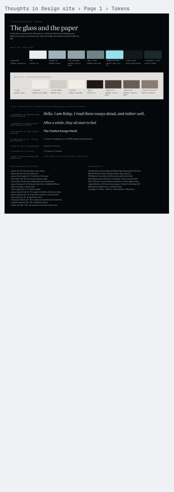

# Paper Peek

Paper Peek shows a Paper artboard beside your code.

The bar widget is a dot. The tooltip reads Live, Not live, or Off. Click the dot to open the drawer. Press `SUPER + SHIFT + H` to open it, and press that hotkey again to close it.

The drawer slides in from the right. The header shows the project, the page, and the artboard. Float moves that artboard to a card in the bottom-right corner. Browse opens the project list. The corner card stays up when you change workspace.



## Requirements

You need Omarchy 4. Paper Desktop has to be open, with a file already loaded.

Paper Peek reads the open file. It does not open a file in Paper. A screenshot needs that file to already be open.

## Install

Add the plugin from its git repository.

```bash
omarchy plugin add https://github.com/binaryfever/omarchy-paper-peek
```

The command clones the repository and validates `manifest.json`. Enable Paper Peek when the command asks. You can also enable it later.

```bash
omarchy plugin enable fmchale.paper-peek
```

The dot's default place is the left of the bar.

Remove the plugin with this command.

```bash
omarchy plugin remove fmchale.paper-peek
```

The plugin id is `fmchale.paper-peek`.

## Hotkeys

`SUPER + SHIFT + H` toggles the peek. The hotkey runs `omarchy-shell fmchale.paper-peek toggle`.

`browserHotkey` is empty until you set it. An empty value adds no hotkey. A set value runs `omarchy-shell fmchale.paper-peek browser`.

While the drawer shows the artboard, F opens the corner float. Escape closes the drawer. Return opens the project browser.

While the corner float is open, F returns to the drawer. C passes clicks through the card, and the label changes from Clicks to Passing. Escape hides the card.

`omarchy-shell fmchale.paper-peek layout` switches between the drawer and the corner float.

## Settings

Change Paper Peek in `~/.config/paper-peek/settings.json`. With no file, Paper Peek keeps the defaults in the table. An invalid value falls back to that default. The shell logs a warning that starts with `paper-peek:`. Saving a new `drawerSide` moves the open drawer without a shell restart.

`defaultMode` applies the next time you open Paper Peek. It does not move a peek that is already open.

| Key | Default | What it sets |
| --- | --- | --- |
| `toggleHotkey` | `SUPER + SHIFT + H` | Hotkey that toggles the peek |
| `browserHotkey` | empty | Hotkey that opens the project browser. Empty adds no hotkey |
| `drawerSide` | `right` | `left` or `right` |
| `drawerWidth` | `480` | Drawer width in pixels, from 240 to 1200 |
| `refreshIntervalMs` | `2000` | Milliseconds between Paper checks, from 500 to 60000 |
| `defaultMode` | `drawer` | `drawer`, `float`, or `dock` on the next open |
| `paperAddress` | `127.0.0.1:29979` | Paper host and port. Requests use that host and port on the path `/mcp` |

Leave a key out to keep its default. `PAPER_MCP_URL` overrides `paperAddress` when you run `scripts/paper-fetch` yourself. When this file exists, the drawer uses the address from the file.

```json
{
  "drawerSide": "left",
  "drawerWidth": 560
}
```
