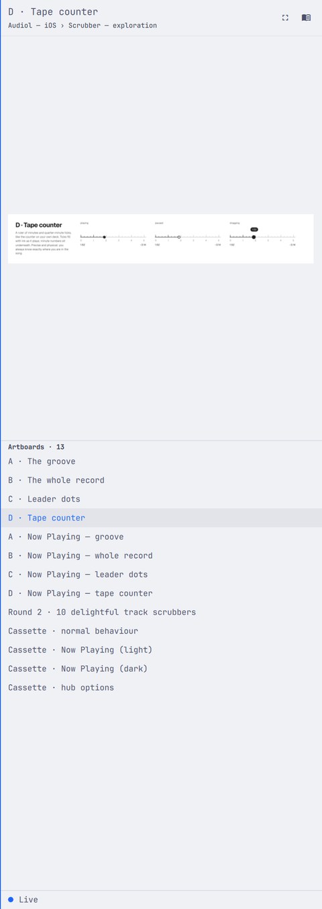
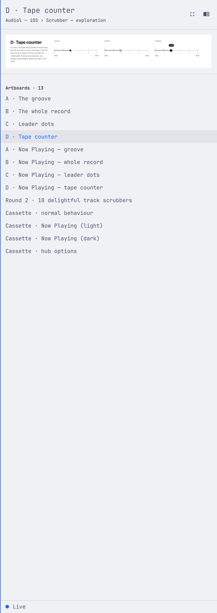

# The drawer's sections sit together

Four changes to the drawer's vertical rhythm. The shot pane stops at the
artboard it holds instead of always taking its cap. The header pads the same
amount on all four sides. A section label takes its air above, not below. The
header title moves up one step on Omarchy's type scale.

 

A 1440 by 250 artboard, before and after, at 480 by 1350.

## Why

Measured on that drawer with a row-mean profile, the before column reads:
header 0–53, then 264 pixels of nothing, 73 pixels of artboard, another 263 of
nothing, rule and label at 655–711, rows to 1024, 296 more of nothing, footer.
527 pixels of void — 39% of the drawer — sitting between the three things that
are supposed to read as one panel. Proximity is the only signal a reader has
for what belongs with what, and the drawer was using it to say the header, the
artboard and the list are unrelated.

The void came from `docs/decisions/017-layout-from-the-mockups.md`. That
record capped the shot pane so a 393 by 852 artboard lands the same size on a
1080p monitor and a 4K one, which is right. The cap then got used as the
pane's height for every artboard, whatever shape it was, so a squat artboard
drew 73 pixels of ink inside a 600 pixel box. A cap is a ceiling, not a
height.

The label had the opposite problem: the same air above and below, so
"Artboards · 13" read as belonging to neither the rule over it nor the rows
under it. A section label is a caption for the rows it introduces.

And the type ran 14 / 12 / 10 — a flat two-pixel ladder carrying three levels
of meaning. The artboard's name is what the drawer is for; it should not be
two pixels away from a row label.

## What changed

`contentFrame` in `src/drawer-layout.js` fits the image, then, when the fitted
image plus its insets comes in under the cap, shrinks the pane to that and
hands the difference to the list. An artboard whose size the image has not
reported yet has no shape to fit, so the pane holds the cap until it does.

`chrome` gained `framePadY`, the gutter, which `HeaderStrip` now uses top and
bottom in place of the column gap. The header box pads 12 on every side
instead of 12 at the sides and 8 top and bottom.

`chrome.captionLead` is two gutters, 24, and `captionHeight` is the label plus
that lead and nothing under it. The caption delegate spends the lead as
`topPadding`, which replaces `PanelSectionHeader`'s own glyph-overshoot
reserve of `ceil(fontSize * 0.15)` — 24 clears that two-pixel sliver many
times over, so no label gets beheaded by the list's clip.

The header title is `Style.font.heading` (16) rather than `Style.font.title`
(14). Rows stay at `body` (12); the breadcrumb, the labels and the footer stay
at `caption` (10). The ladder is 16 / 12 / 10: the artboard's name, the rows
that lead to it, the chrome around it. `heading` is what Omarchy's own agents,
clipboard, emojis, menu, lock and bluetooth panels use, so this stays inside
the platform's scale rather than inventing a size.

## What it measures

The same drawer, after, in logical pixels: top padding 16, title 16–35,
breadcrumb 41–48, 16 to the rule at 64, 13 to the artboard, artboard, 13 to
the rule, 26 to the label, label, 16 to the first row, rows at a 28 pitch, and
the leftover space at the bottom where a short list ends.

The label now has 26 above it and 16 below — a ratio of 1.6, and the 16 is
tighter than the list's own 28 pitch, so the label reads as part of the list
it names. The void between sections is gone; what is left over sits under the
last row, which is what a list shorter than its viewport looks like.

## Proof

Every `src/*.test.ts` printed `ok`. `drawer-layout.test.ts` covers the fitted
landscape pane, the 1440 by 250 case that showed the problem, the unmeasured
artboard holding the cap, the even frame padding and the label's lead.

`omarchy plugin validate ~/.config/omarchy/plugins/fmchale.paper-peek` exited
0. `omarchy restart shell` loaded the QML with no warning from the plugin.

The two images above are `grim` captures of the same artboard, same theme,
with and without the change. The browser view was checked too: "Recent" and
"Projects" both break from the rule above and bind to their rows.
