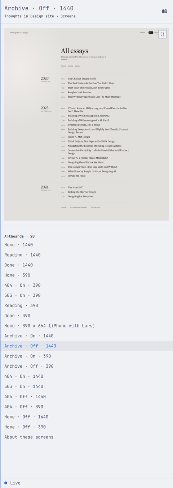
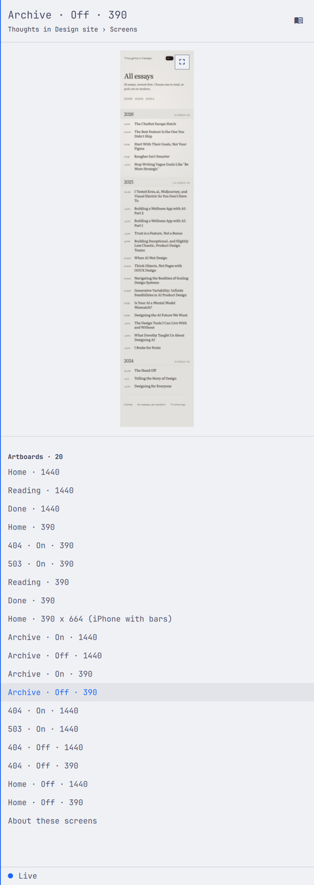

# The artboard carries its own control

The control that opens the big view moved out of the drawer's header and onto
the artboard's own top right corner.

 

The same artboard, before and after, at 480 by 1350.

## Why

The header strip carries the drawer's actions. Back walks the browser out,
Browse walks it in, Refresh reloads the project list. They act on the drawer:
where it is and what it holds. Expand does not. It acts on the artboard in the
pane below, and in that row there was nothing to say so — three glyphs in a
line, two of them about the drawer and one about something else.

`docs/decisions/018-the-big-view.md` made the whole shot pane a click target,
which is the right gesture: the artboard is what you want bigger, so clicking
the artboard is how you ask. Nothing on screen said so. The glyph that should
have been that sign sat outside the pane, above the rule, in a row of drawer
chrome.

A control belongs to the thing it changes, near enough that the two read as
one. That is the same reading `docs/decisions/021-the-sections-sit-together.md`
applied to the drawer's sections, applied now to a single control.

## Why the artboard's corner, not the pane's

The shot pane is as wide as the drawer. The artboard inside it is not. On this
480 drawer the page artboard draws 109 wide and the desktop artboard 456, both
in the same pane, so a control pinned to the pane's corner sits 6 pixels from
one artboard's edge and 179 from the other's. It would read as attached to one
and adrift on the next.

Pinned to the artboard instead, it is in the same place on every artboard: the
top right corner, half the artboard's own margin in from each edge. The corner
nearest the drawer's edge, so it still lines up with the header's actions down
the same side.

The same control on a 390 wide artboard. The pane's own corner is off to the
right, where nothing is.

It rides on the artboard rather than beside it even when there is room beside
it, because the room depends on the artboard's shape. A control that sits on
the image for one artboard and off it for the next moves every time you change
rows. It costs a 23 pixel corner of the preview; the big view it opens shows
that corner at full size. An artboard too small to give the control a corner
without landing in its middle goes without one, and the click on the pane still
opens it.

## What changed

`headerActions` in `src/drawer-layout.js` no longer returns a zoom action, and
no longer takes `canZoom`. The views keep back, browse and refresh.

`chrome` gained `badge`, the size of a panel action button measured from a real
one, and `badgeInset`, half the gutter. `contentFrame` returns `shot.badge`,
the control's square in the pane's coordinates, or null when the artboard is
smaller than twice the control plus its inset in either axis. An unmeasured
artboard has no shape to hang it on, so it gets null until the image reports
one.

`Drawer.qml` draws that square inside `ShotStage`, after the pane's own
MouseArea so it takes the click it advertises. The chip is the theme's popup
background at full alpha — the theme's own value carries alpha for the blur
behind a panel, which over an artboard reads as a smudge of the design, and a
pale artboard would swallow the glyph. The button on top is Omarchy's
`PanelActionButton` with `bordered: true`, so the border is the platform's
quiet one at rest and the accent under the pointer, like every other bordered
control in the shell. Its tooltip reads Expand. Its glyph comes from
`Layout.actionIcon("zoom")`, the same glyph the header used.

Space still opens the big view, and so does a click anywhere on the pane.

## What it measures

In logical pixels, on a 480 drawer: the control is 23 square, the theme's size
for a panel action, and sits 6 in from the artboard's top and right edges, half
the 12 the artboard keeps off the pane. On the desktop artboard above that puts
it at x 439, on the page artboard at x 266. The pane's corner is at 445 for
both.

## Proof

Every `src/*.test.ts` printed `ok`. `drawer-layout.test.ts` covers the corner on
a portrait and a landscape artboard, the chip following the artboard inward
rather than the drawer's edge, the thin artboard and the unmeasured artboard
that carry none, and the header offering no zoom action in any view. It also
reads `Drawer.qml` to check the chip is declared in the shot pane and not in
the header, after the pane's click target, and that it takes its corner from
the layout rather than its own arithmetic.

`omarchy plugin validate ~/.config/omarchy/plugins/fmchale.paper-peek` exited
0. `omarchy restart shell` loaded the QML with no warning from the plugin.

The two images above are `grim` captures of the same artboard, same theme, with
and without the change. `022-portrait.png` is the same drawer on a 390 wide
artboard. The big view was opened from the pane and closed again, and
`hyprctl clients` was byte-identical with the drawer open and closed: no window
moved.
